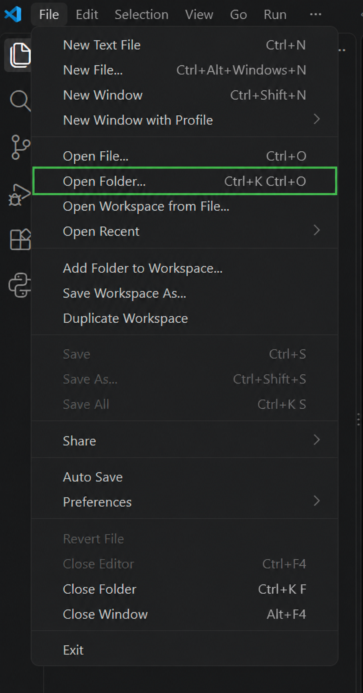
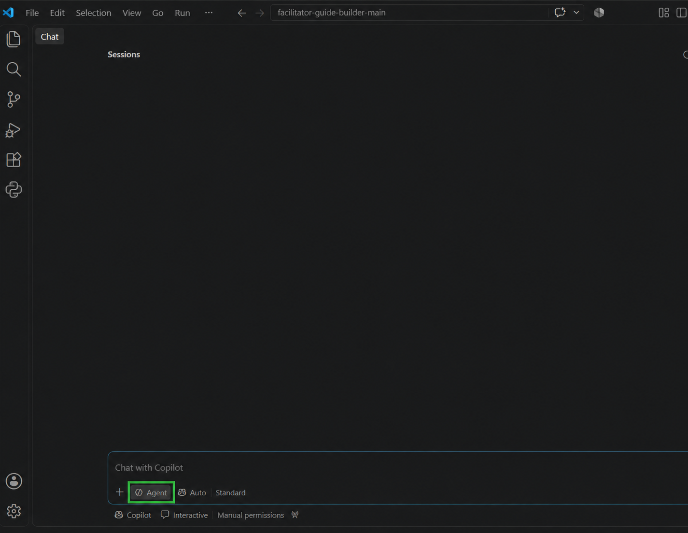

# Facilitator Guide Builder

This demo uses an AI assistant to draft and check a facilitator guide: a plan with instructions for someone leading a learning session. You will use the included fictional notes.

This sample is part of my [Agentic Framework for Learning Programs](https://clairebrittain.com/ai-workflow-for-learning-programs/) portfolio project.

The sample uses fictional text notes, not a slide deck. It includes filler text and a timing conflict so you can try the review process. It is for demonstration, not live delivery.

You can try this without writing your own prompts. Follow the steps below, paste the starting prompt, and select **Run the sample**.

**Use the agentic tool you prefer.** It needs access to read and edit this project's files. The walkthrough below uses GitHub Copilot in Visual Studio Code, where this sample has been tested.

If you use another tool, open the downloaded project folder there and use the same starting prompt in section 2. It names the instruction file directly, so the tool does not have to find it automatically.

## 1. Download and open the sample

GitHub holds the project files. Visual Studio Code is the app where you open them. Copilot is the AI assistant you use inside that app.

For this Copilot walkthrough, you need Visual Studio Code and a GitHub account with Copilot access. If you need an account, [create one on GitHub](https://github.com/signup).

1. [Download and install Visual Studio Code](https://code.visualstudio.com/download) if needed, then open it.
2. [Set up and sign in to GitHub Copilot](https://code.visualstudio.com/docs/setup/copilot) in Visual Studio Code using your GitHub account.
3. Open [this project's main GitHub page](https://github.com/cbrittain1/facilitator-guide-builder). Select the green **Code** button, then **Download ZIP**. Find the ZIP in your Downloads folder. On Windows, right-click it and choose **Extract All → Extract**. On a Mac, double-click it to extract it.
4. In Visual Studio Code, choose **File → Open Folder…**. Choose the extracted folder containing `README.md`, `drafts`, and `standard`. If you see another folder with the same project name, open it to find those items.

   <details>
   <summary><strong>See where to click “Open Folder” in Visual Studio Code</strong></summary>

   

   </details>

5. Click the chat icon at the top of Visual Studio Code to open Copilot Chat. Make sure **Agent** is selected. This mode lets Copilot read the project files and save the draft.

   <details>
   <summary><strong>See where to open Copilot Chat and select Agent</strong></summary>

   The Chat icon is near the top-right of the window. The **Agent** menu is below the message box, near the bottom-left of the chat area.

   

   </details>

You will work with the downloaded copy on your computer. You do not need to edit or upload files on GitHub to try the sample.

## 2. Run the sample

Copy all the text in this box. Paste it into Copilot Chat in Visual Studio Code and press **Enter** to send it:

```text
Read README.md and .github/copilot-instructions.md, then help me get started.
```

Copilot asks:

> Would you like to run the sample?

Select a choice and submit your answer. If no choices appear, type **Run the sample** or **Not now** in the chat and press **Enter**.

| Your choice | What happens next |
|---|---|
| **Run the sample** | Copilot drafts and checks a guide using the included notes, then asks you to resolve any questions. |
| **Not now** | Copilot stops without creating files. |

Copilot waits for your choice before creating files.

## 3. Open the results

When you select **Run the sample**, Copilot creates two files:

- **Draft guide:** The guide written by AI, saved in `drafts/sample-guide-draft.md`.
- **Review table:** The checks, questions, and next step, saved in `records/review-findings.md`.

Click the file links in Copilot's reply to open them. You can also find them in the folder list on the left of Visual Studio Code. Copilot may use new filenames to preserve an earlier run.

These are Markdown (`.md`) text files. To see the formatted headings, lists, and tables, open a file and press **Ctrl + Shift + V** on Windows or **Command + Shift + V** on a Mac.

The download includes starter versions of the draft and review. Copilot fills them in when you run the sample. No Word-export tool or PowerPoint template is included.

## 4. Answer the review questions

Read the review table. It may ask which timing to use when the notes disagree, such as 15 or 20 minutes for practice. Reply in Copilot Chat with your decision. If you cannot answer yet, ask it to leave the question open.

> [!TIP]
> Before deciding, you can ask Copilot: “Show me the exact text in the slide notes or planning notes that supports this review result.”

**Example reply to a timing question:**

> Use 15 minutes for practice and 25 minutes for the session total. Revise the guide and check the timing again. Keep any other unanswered questions open.

**After Copilot revises the guide, ask:**

> Show me what changed and which questions are still open.

## 5. Check the revised guide

Read the revised guide and review table. Check that Copilot applied your decisions and kept any unanswered questions visible. Ask for more changes if needed.

If you are satisfied, you can approve the sample as a demonstration:

> I approve this guide as a demonstration. Save a copy in `finished-guides/` and keep the draft and review records.

The saved guide is still a fictional example. It does not become ready for live delivery just because it is approved as a demonstration.

<details>
<summary><strong>See what's included in this sample</strong></summary>

The folders below hold the sample notes, Copilot instructions, draft guides, and review results.

```text
.github/
  copilot-instructions.md      Project context and instructions
  skills/
    build-guide/SKILL.md       How to build or revise a guide
    check-guide/SKILL.md       How to review a guide
standard/
  guide-requirements.md        Required content and review labels
  template.md                  Guide structure
  example-guide.md             Fictional worked example
source-materials/
  sample-session/              Slide notes and planning notes
drafts/                        Guides being worked on
records/
  review-findings.md           Review table and next step
  decision-log.md              Confirmed decisions for future guides
finished-guides/               Approved guides
```

- [Guide requirements](standard/guide-requirements.md): What a guide must include and how to check it. A requirement is something the guide needs to contain or follow.
- [Template](standard/template.md): The guide layout.
- [Example guide](standard/example-guide.md): The expected detail.
- [Build Guide](.github/skills/build-guide/SKILL.md) and [Check Guide](.github/skills/check-guide/SKILL.md): The instruction sets, called agent skills, that Copilot reads to draft, revise, and review the guide.

### What the review labels mean

| Label | Meaning |
|---|---|
| **Meets requirement** | The required content is present and supported by the notes. |
| **Missing** | Needed information is absent from the draft or notes. |
| **Conflicting** | The notes or draft give different information. |
| **Needs clarification** | Something is unclear or too vague to use. |
| **Inferred** | The draft includes an assumption the notes do not confirm. |

These labels describe individual checks. You decide when the whole guide is ready to approve.

</details>
