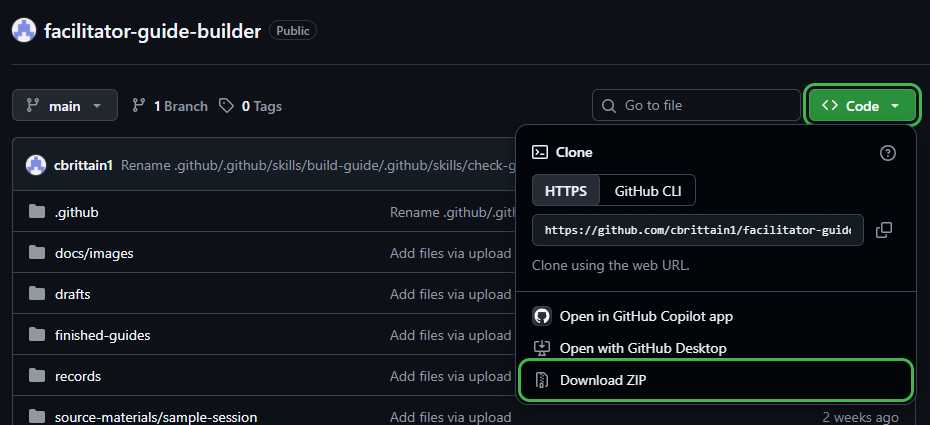

# Facilitator Guide Builder

Use AI to draft and check a facilitator guide: a plan for someone leading a learning session.

- **[Starting prompt](#starting-prompt):** After setup, paste this into the AI chat to begin.
- **Included:** Fictional slide notes and planning notes with filler text. The notes give different times for the same activity. No slide deck is included.
- **Choose your tool:** Follow the Copilot walkthrough below, or use another AI assistant that can read and edit the project files.

## 1. Download and open the sample

GitHub is the website holding these files. Visual Studio Code is the app where you open them and chat with Copilot, its AI assistant.

1. [Download and install Visual Studio Code](https://code.visualstudio.com/download) if needed, then open it.
2. [Set up GitHub Copilot](https://code.visualstudio.com/docs/setup/copilot) in Visual Studio Code and sign in. You need a GitHub account with Copilot access; [create an account](https://github.com/signup) if needed.
3. Open [this project's GitHub page](https://github.com/cbrittain1/facilitator-guide-builder). Select the green **Code** button, then **Download ZIP**.

   <details>
   <summary><strong>See where to click Code → Download ZIP</strong></summary>

   The **Code** button is above the file list. Click it, then choose **Download ZIP** from the menu. Both are outlined in green below.

   

   </details>

   Find the ZIP in Downloads and unpack it:
   - **Windows:** Right-click the ZIP → **Extract All → Extract**.
   - **Mac:** Double-click the ZIP.
4. In Visual Studio Code, choose **File → Open Folder…**. Select the unpacked folder containing `README.md`, `drafts`, and `standard`. If another folder is inside it, open that folder to find those items.

   <details>
   <summary><strong>See where to click “Open Folder” in Visual Studio Code</strong></summary>

   

   </details>

5. Click the chat icon at the top of Visual Studio Code to open Copilot Chat. Make sure **Agent** is selected. This mode lets Copilot read the project files and save the draft.

   <details>
   <summary><strong>See where to open Copilot Chat and select Agent</strong></summary>

   The Chat icon is near the top-right of the window. The **Agent** menu is below the message box, near the bottom-left of the chat area.

   

   </details>

You work with the copy on your computer. You do not need to edit or upload anything on GitHub.

## 2. Run the sample

### Starting prompt

Copy the text below into the **Copilot Chat message box**, then press **Enter**:

```text
Read README.md and .github/copilot-instructions.md, then help me get started.
```

**Using another tool?** Open the unpacked project folder there and paste the same prompt. Only Copilot has been tested with this sample.

Copilot asks:

> Would you like to run the sample?

Select **Run the sample** and submit your answer. If no choices appear, type **Run the sample** in the chat and press **Enter**. To stop without changing files, choose or type **Not now**.

Copilot drafts and checks the guide, creates an HTML review page, and asks you about anything that needs a decision.

## 3. Open the results

Open **`drafts/sample-review.html`** in your browser. It shows the draft guide and review findings together, with colored labels for anything needing attention.

If Copilot's link opens code instead of the page:

1. Find `sample-review.html` inside **drafts** in Visual Studio Code's file list.
2. Right-click it → **Reveal in File Explorer** (Windows) or **Reveal in Finder** (Mac).
3. Open the file with a web browser, such as Edge, Chrome, or Safari.

Use the filename Copilot gives you if it saved a new version. It also keeps text records in `drafts/sample-guide-draft.md` and `records/review-findings.md`.

## 4. Answer the review questions

Read the review findings on the HTML page. For example, the notes disagree on whether practice lasts 15 or 20 minutes. Tell Copilot which to use. Leave any questions you cannot answer open.

> [!TIP]
> Ask Copilot: “Show me the exact text in the slide notes or planning notes that supports this review result.”

**Example reply to a timing question:**

> Use 15 minutes for practice and 25 minutes for the session total. Revise the guide and check the timing again. Keep any other unanswered questions open.

**After Copilot revises the guide, ask:**

> Show me what changed and which questions are still open.

## 5. Check the revised guide

Refresh the HTML page after Copilot updates it. Check that it made your changes and kept unanswered questions visible. Ask for more changes if needed.

If you are satisfied, you can approve the sample as a demonstration:

> I approve this guide as a demonstration. Save a copy in `finished-guides/` and keep the draft and review records.

The saved guide is a fictional demonstration, not a guide for live delivery.

<details>
<summary><strong>See what's included in this sample</strong></summary>

The folders below hold the sample notes, Copilot instructions, draft guides, and review results.

```text
.github/
  copilot-instructions.md      Project context and instructions
  skills/
    build-guide/SKILL.md       How to build or revise a guide
    check-guide/SKILL.md       How to review a guide
standard/
  guide-requirements.md        Required content and review labels
  template.md                  Guide structure
  example-guide.md             Fictional worked example
  review-template.html         Layout and label colors for the HTML review
source-materials/
  sample-session/              Slide notes and planning notes
drafts/                        Draft guides and HTML review pages
records/
  review-findings.md           Review table and next step
  decision-log.md              Confirmed decisions for future guides
finished-guides/               Approved guides
```

- [Guide requirements](standard/guide-requirements.md): What a guide must include and how to check it.
- [Template](standard/template.md): The guide layout.
- [Example guide](standard/example-guide.md): An example of the structure and level of detail.
- [HTML review template](standard/review-template.html): The layout used for the generated browser page.
- [Build Guide](.github/skills/build-guide/SKILL.md) and [Check Guide](.github/skills/check-guide/SKILL.md): Step-by-step instructions for the AI assistant. These are called agent skills.

### What the review labels mean

| Label | Meaning |
|---|---|
| **Meets requirement** | The required content is present and supported by the notes. |
| **Missing** | Needed information is absent from the draft or notes. |
| **Conflicting** | The notes or draft give different information. |
| **Needs clarification** | Something is unclear or too vague to use. |
| **Inferred** | The draft includes an assumption the notes do not confirm. |

These labels describe individual checks. You decide when the whole guide is ready to approve.

</details>

Part of my [Agentic Framework for Learning Programs](https://clairebrittain.com/ai-workflow-for-learning-programs/) portfolio project.
